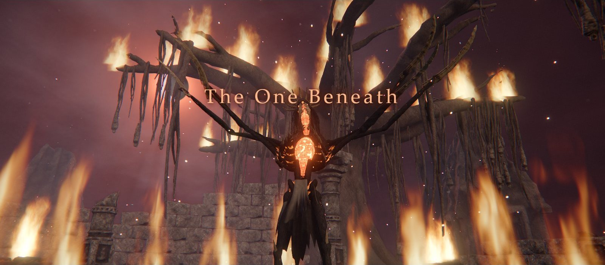
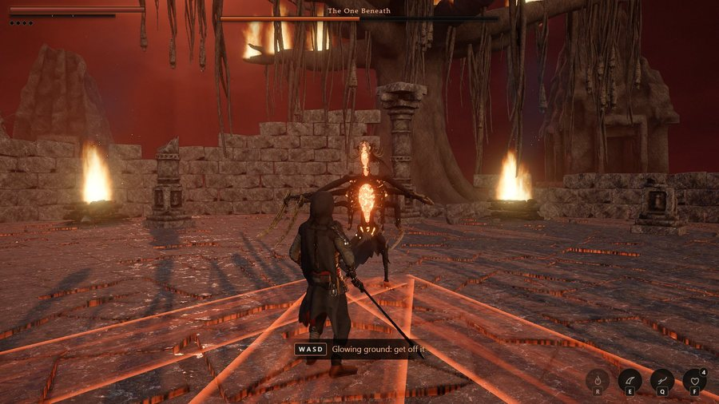
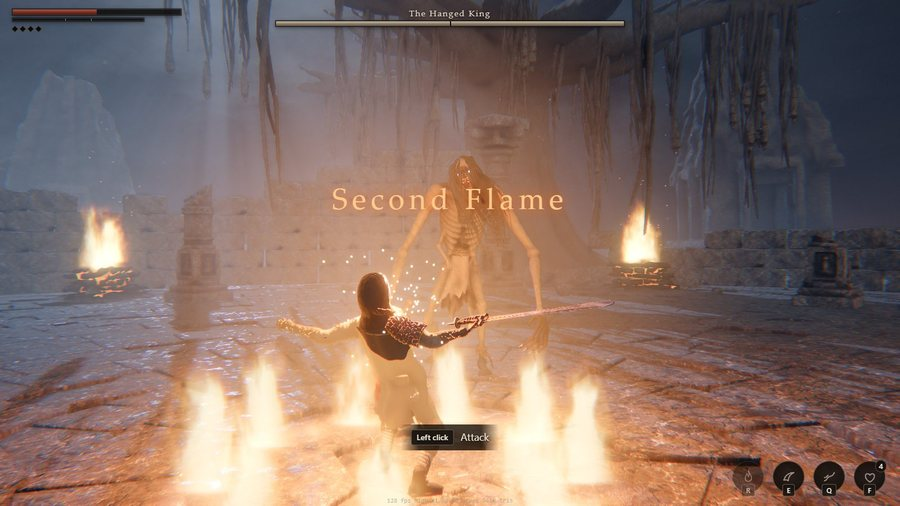

<div align="center">



# PYREWAKE

**A dark boss-fight action game that runs in the browser, on desktop and on phones.**
No game engine, no model files, no motion capture, no audio files. Everything is code.

</div>

You are the Pyrekeeper, a human who tends the cremation fires and has died once beside them. Something that hangs in the old banyan has started wearing the dead.

## The fight in four lines

1. Hit the boss and its health goes down. Your normal attack always works on it.
2. When it attacks, dodge or guard.
3. Landing hits fills your fire. Spend fire on skills.
4. At half health it changes. Beat that too.

| | |
|---|---|
|  |  |
|  |  |
|  |  |

**One rule for reading danger:** a white star means dodge *or* guard, a red diamond means dodge, glowing ground means move. Each differs in shape and sound as well as colour.

**Round 1, the Hanged King:** fights on two feet, then on all fours, then hanging upside down from the tree, where its head swings at sword height.
**Round 2, the One Beneath:** what was wearing it. Six arms, a burning court, an eclipse.

### One button, many answers

| Do this | Get this |
|---|---|
| tap Attack | five-hit chain |
| pause after hit two, then tap | a second chain: cross cuts, spinning kick, fire wave |
| hold Attack after hit 1, 2, 3 or 4 | rising cut, spinning cleave, thrust, ground slam |
| hold Attack from rest | charged heavy |
| sprint, then Attack | a leaping turn into a falling cut |
| dodge, then Attack | forward: low turn; sideways: passing cut; back: thrown fire |
| Guard, then Attack | a burst from the burnt hand |
| parry or last-instant dodge, then Attack | six cuts and a wait |
| Attack a kneeling boss | execution |
| keep hitting without being hit | your aura builds in four steps |

## Play

```bash
npm install
npm run dev        # http://localhost:5173
npm run dev:lan    # then open the printed Network address on a phone, in landscape
```

| | Keyboard and mouse | Gamepad | Touch |
|---|---|---|---|
| Move | W A S D | left stick | drag on the left |
| Attack (hold for heavy) | left click or J | X | Attack |
| Dodge | Space | B | Dodge |
| Guard (tap at the last moment to parry) | right click or K | LB | Guard |
| Cinder Rush | Q | RB | Rush |
| Sunder Arc | E | RT | Sunder |
| Last Rites (when ready) | R | both sticks | Rites |
| Heal | F | D-pad up | Heal |
| Pause | Esc | Start | pause icon |

## How it's made

| Part | Approach |
|---|---|
| Characters, weapons, arena | signed-distance sculpting in TypeScript, meshed and baked at build time by `forge/` |
| Motion | a small clip language over named pose channels, solved with two-bone IK, foot locking, inertialised blending, and simulated cloth and hair |
| Combat | 60 Hz fixed step with no rendering imports, so whole fights run headless in tests |
| Rendering | three.js (WebGL 2) with one layered surface shader, own HDR chain, height fog, GPU particles |
| Sound | 118 sounds synthesised sample by sample in a worker (modal metal, formant voices, debris, fire), a court reverb, and an adaptive score |
| Checks | unit tests, bots that play hundreds of headless fights, per-tier performance budgets, scripted screenshots |

```
forge/        build-time sculpting, meshing, baking
src/combat/   rules, hits, difficulty   (no rendering)
src/weapons/  one module per weapon
src/player/   movement and state
src/boss/     simulation, moves, brain, drawing
src/anim/     rig, IK, clips, cloth, gaits
src/render/   shaders, post, effects
src/game/     camera, effects director, cutscenes
src/audio/    synthesis, score
src/ui/ src/input/ src/arena/ src/core/
```

## Commands

| Command | Does |
|---|---|
| `npm test` | combat, fairness, motion and bot tests |
| `npm run build` | typecheck and production build into `dist/` |
| `npm run perf` | triangle, draw and input checks on all three tiers |
| `npm run soak` | a bot plays the real game and reports hitches (`-- --phone --secs=90`) |
| `npm run fight` | scripted fight that captures every beat (`-- --phone`) |
| `npm run shots`, `npm run sheets` | stills, motion contact sheets |
| `npm run sfx` | renders every sound, prints levels, draws spectrograms |
| `npm run moments` | drives the game to each key moment and captures it |
| `npm run forge [names]` | rebake models (`textures` needs the CC0 sources in `assets_src/`) |

Address options: `?nointro`, `?still`, `?touch`, `?tier=phone|mid|high`, `?bench=player`, `?bench=king`, `?bench=beneath`, `?shot=<name>`, `?round2` (start in round 2), `?turn` (one hit from the cutscene).

## Licence

Copyright © 2026 pranavraj012. All rights reserved. The source is visible for reading; it is not licensed for reuse or redistribution. Third-party material is listed in [LICENSES.md](LICENSES.md).
